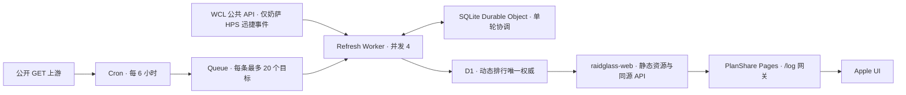

# RaidGlass 生产架构

## 数据流



Production 与 Preview 使用同一源码合同和完全隔离的 Cloudflare 资源。Preview 默认没有 Cron。

## 排行矩阵

`contracts/ranking-matrix.mjs` 是矩阵单一权威。它从 `frontend/config/product.json`、roles、specs 和当前赛季 zones 生成目标：

- 10 个首领。
- 40 个战斗专精。
- Heroic、Mythic 两个难度。
- `mdps/rdps`：`dps`、`bossdps`。
- `heal/tank`：`dps`、`hps`、`bossdps`。
- Midnight Season 2 当前矩阵包含 1674 个专精目标、9 个阵容目标，总计 1683 个。
- Queue 每条业务消息最多 20 个目标。

Node、Edge 与 Pages 合同测试共同锁定矩阵 ID、角色指标和 `1674 + 9` 计数。

## D1 数据

`edge/migrations/0001_dynamic_rankings.sql` 是结构权威：

- `ranking_targets`：每个目标一行，同时保存身份、Top10 JSON 和 `fresh/stale` 状态。
- `global_status`：固定单例行，保存当前矩阵 1683 个目标的全局计数和当前/最近 run。

排行和目标状态在同一条 D1 UPSERT 中原子更新。成功刷新覆盖排行；上游失败只更新 `stale`、检查时间和错误码，旧排行字节保持不变；首次失败时排行为空，Pages API 返回结构化 JSON `503`。

当前公开阵容上游缺少 `lura` 与 `rotmire`。`edge/scripts/reference-comp-seed.mjs` 从保留的 WCL 原始排行和战斗摘要生成一次性历史种子，只填补 `ranking_json IS NULL` 的行。两项目标保持 `stale`，错误码保持真实上游结果；正常公开 GET 恢复后，刷新链会覆盖历史种子。页面运行时仍只读 D1，不读取仓库静态排行。

Durable Object 只负责 run、batch、失败目标与去重。每次新 run 开始时清理超过 30 天的历史轮次；`latest_targets` 继续保存当前协调状态。D1 是页面可读取动态数据的唯一权威。

## 刷新语义

专精目标先请求公开 `/info`。`updated` 与 D1 行一致且已存排行通过身份校验时，只更新检查状态；发生变化时读取完整排行、校验目标身份并裁剪 Top10。

奶萨 HPS 目标每轮都读取完整排行，再用 WCL 当前公开排行按 `report code + fight ID` 精确匹配 Top10，仅补充自然迅捷 `378081` 与先祖迅捷 `443454` 的 `applybuff` 时间点。无法匹配、WCL 失败或达到每小时 10% 预算时保留原排行；日志记录匹配报告数、补入事件数、额度和失败原因。

阵容目标每轮请求一次公开 GET，固定 `limit=20`，校验身份后裁剪 Top10。

D1 写入发生在 Durable Object 记录终态之前。D1 写入失败时 Queue 重试，Durable Object 不会误记完成；D1 已写入而协调记录失败时，重试会复用已存排行完成闭环。局部刷新失败时，协调器根据 D1 中是否仍有已验证排行计算 `available_count`，因此历史排行可用性与当前新鲜度分别计数。

## API 合同

专精与阵容排行都包含：

```json
{
  "refresh": {
    "status": "fresh",
    "checked_at": "2026-08-09T12:00:00.000Z",
    "published_at": "2026-08-09T12:00:00.000Z",
    "upstream_updated": "2026-08-09T11:55:00.000Z",
    "last_error_code": null
  }
}
```

超过 8 小时没有成功检查时，Web Worker 将结果按 `stale` 提供。旧排行仍可展示，页面明确显示“数据已过期”。排行缺失、状态损坏、JSON 损坏或身份错误统一返回 JSON `503`。公开 API 位于 `/log/api/*`。

- `/log/api/health`：Worker Assets、D1 模式、1683 可用数和全局新鲜度。
- `/log/api/admin/refresh-state`：当前/最近 run、专精与阵容的 fresh/stale/unchecked 计数。
- `/log/snapshot-manifest.json`：schema v2，只描述 UI、Web Worker、静态资源和构建身份。

## 免费额度设计

每天四轮刷新约产生 376 条 Queue 消息，即约 1128 次标准操作；D1 刷新约读写 7480 行。当前 Workers Free 额度分别为 Queue 10000 次操作/日、D1 500 万行读取/日和 10 万行写入/日。Top10 样本总数据预计约百 MB，低于 D1 免费总存储 5 GB。免费额度触顶时 Cloudflare 返回错误，Queue 重试或下一轮继续处理，旧排行保持可用。

WCL 补采只覆盖奶萨 HPS，并在 `pointsSpentThisHour >= limitPerHour * 10%` 时停止本轮补采；其余专精和指标不调用 WCL。

## 发布与恢复

`frontend/scripts/build-candidate.mjs` 生成隔离候选。类型、单元、Node、Worker、构建和浏览器门禁通过后，把同一候选 build 依次部署到 `raidglass-web-preview` 与 `raidglass-web`，最后部署 PlanShare Pages 网关绑定。

页面切换后发生严重问题时：

1. 清空 Production Cron。
2. `raidglass-web` 回滚到上一份已验证版本。
3. Refresh Worker 重部署上一份已验证源码；必要时将 PlanShare `/log` 绑定回上一 Web Worker。
4. 保留 Durable Object namespace，不做 SQLite 反向迁移。
5. D1 保持原数据；只有确认数据已污染时才使用 D1 Time Travel 恢复。
6. 重新执行线上 API、桌面和 430px 关键流程。
